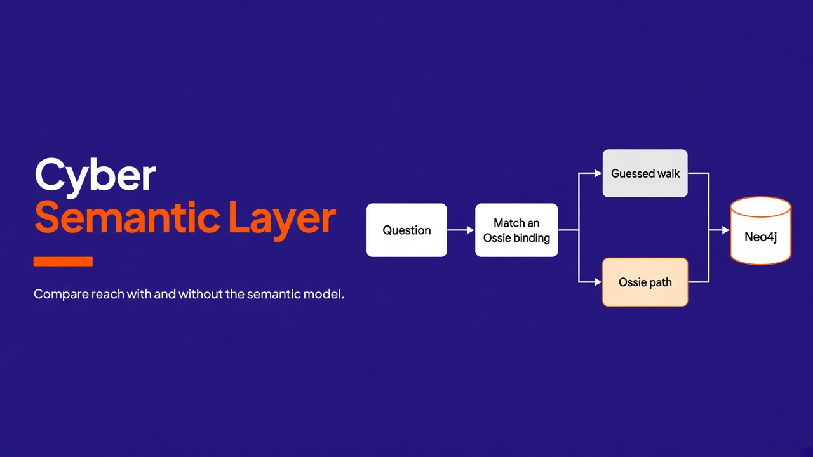
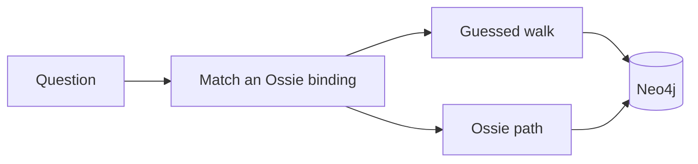
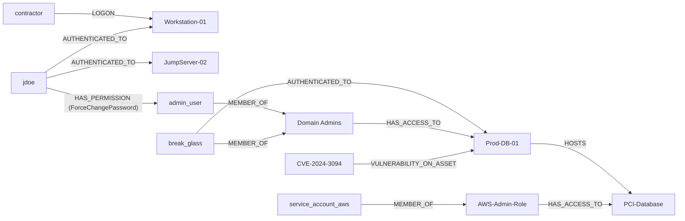
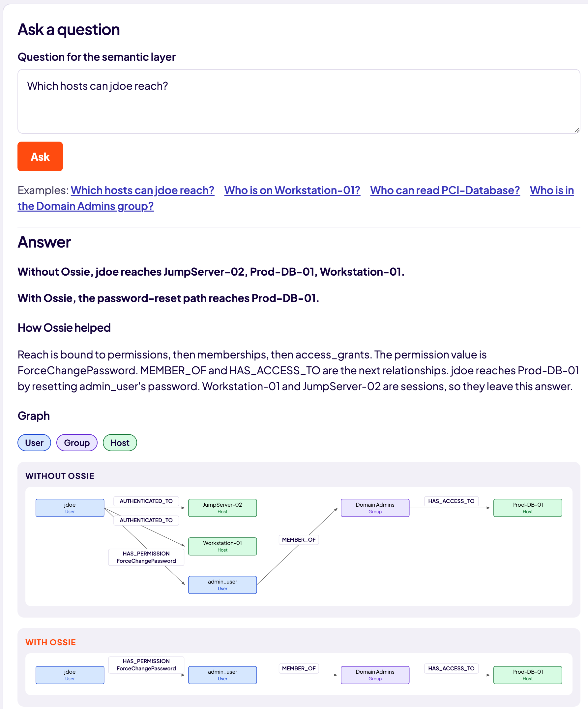
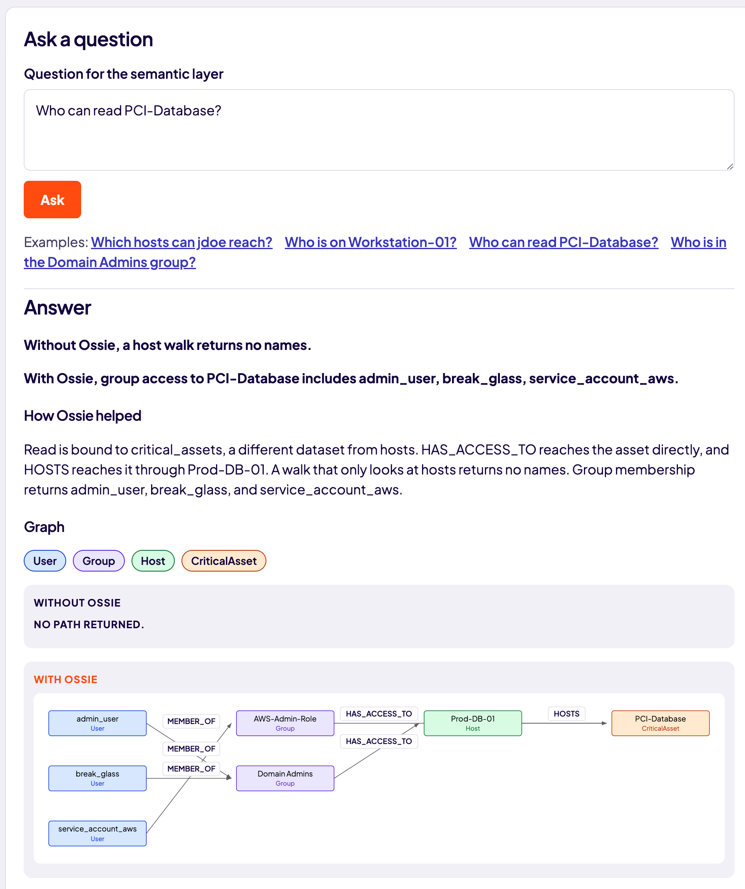
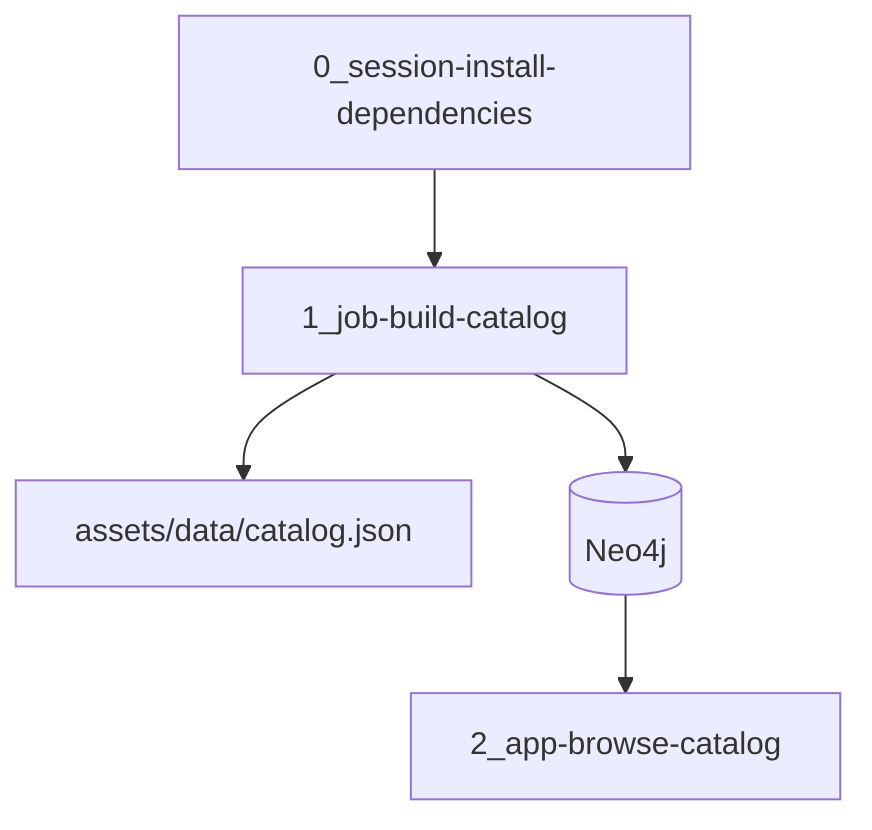

# Cloudera Blueprint: Cyber Semantic Layer

[](LICENSE)
[](https://www.python.org/downloads/)
[](https://github.com/BrooksIan/CyberSemanicLayer/stargazers)
[](https://github.com/BrooksIan/CyberSemanicLayer/forks)
[](https://github.com/BrooksIan/CyberSemanicLayer/watchers)

A semantic knowledge layer for cybersecurity posture. Ossie binds each question to the relationships that question means, and the browser compares that answer with a guessed walk over the same Neo4j graph. Cloudera Machine Learning hosts the install, the catalog job, and the application.



## Table of Contents

- [Overview](#overview)
- [Demo](#demo)
- [Use Case](#use-case)
- [Key Features](#key-features)
- [Quickstart](#quickstart)
- [Architecture](#architecture)
- [Target Audience](#target-audience)
- [Repository Structure](#repository-structure)
- [Prerequisites](#prerequisites)
- [Hardware Requirements](#hardware-requirements)
- [Documentation](#documentation)

## Overview

The layer answers four questions about a demo graph of users, groups, hosts, and a PCI asset: who can reach a host, who has a session on a workstation, who can read a critical asset, and who belongs to a group. Each question runs twice. The guessed walk follows edges of several types. Ossie follows the relationship types named in [Semantic knowledge layer](docs/semantic-knowledge-layer.md).



jdoe holds sessions on Workstation-01 and JumpServer-02, and a `ForceChangePassword` right over `admin_user`. Domain Admins can open Prod-DB-01, which hosts PCI-Database. `contractor` has a logon on the workstation. `service_account_aws` reaches the PCI asset through AWS-Admin-Role.



The build job also writes a catalog snapshot of entity kinds, relationships, and metrics to `assets/data/catalog.json`. That file is the shared vocabulary for detections and dashboards. The sample covers assets, identities, alerts, vulnerabilities, and incidents.

## Demo

A Reprise walkthrough is not recorded yet. Leave `reprise_link` empty in [`METADATA.yaml`](METADATA.yaml) until one exists.

Locally, the walkthrough is the browse application. Ask one of the example questions and compare the guessed walk with the Ossie path.

**Which hosts can jdoe reach?** The guessed walk includes both sessions and Prod-DB-01. Ossie keeps the password-reset path.



**Who can read PCI-Database?** A host walk returns no path. Ossie follows group access to the critical asset.



## Use Case

Security data is easy to collect and hard to query with a stable meaning. A variable-length walk will treat a logon, a session, and a password-reset right as the same kind of reach. This blueprint keeps one graph and one set of bindings so detections, dashboards, and agents can ask the same question and get the path the question names.

## Key Features

- Posture questions for shadow admin, lateral movement, critical-asset access, and group membership
- Each question shown as a guessed walk and as an Ossie-bound path, with the Cypher and the returned graph
- Reach questions that rebind to `jdoe`, `admin_user`, `service_account_aws`, `contractor`, or `break_glass`
- A catalog snapshot of entity kinds, relationships, and metrics
- A Cloudera Machine Learning session, job, and application
- No GPU required

## Quickstart

1. Clone this repository.
2. Create a virtual environment and install the Neo4j driver. The session script installs `requirements.txt`. The job and the application import the model from `src/`, so the session does not build the package.

   ```bash
   python3 -m venv .venv
   source .venv/bin/activate
   python3 0_session-install-dependencies/install-dependencies.py
   ```

   To run the tests, install the package as well: `pip install -e ".[dev]"`.

3. Start Neo4j, seed the demo graph, and open the browser:

   ```bash
   export NEO4J_URI=bolt://localhost:7687
   export NEO4J_PASSWORD=cyber-semantic-layer
   docker compose -f deploy/docker-compose.yml up -d
   python3 1_job-build-catalog/job.py
   python3 2_app-browse-catalog/app.py
   ```

   Then open `http://127.0.0.1:8080`. Neo4j Browser is at `http://127.0.0.1:7474` (user `neo4j`, password `cyber-semantic-layer`). `deploy/run-local.sh` starts Neo4j, seeds it, and serves the app.

4. To launch it from the CML AMP catalog, add [`catalog-entry.yaml`](catalog-entry.yaml) as a catalog source. Its `git_url` already points at this repository. Site Administration steps are in the [CML community AMP template](https://github.com/cloudera/CML_Community_AMP_Template).

## Architecture

The package in `src/cyber_semantic_layer` holds the catalog and the question bindings. The numbered folders are the CML steps, in order. The job writes the catalog snapshot and seeds Neo4j. The application matches a question and runs both Cypher queries.



Component detail is in [docs/architecture.md](docs/architecture.md). The model is in [docs/semantic-knowledge-layer.md](docs/semantic-knowledge-layer.md).

## Target Audience

- Security data engineers defining a shared model over telemetry
- Detection engineers who need stable meanings for reach, session, membership, and access
- Solution architects packaging the catalog as a Cloudera blueprint

## Repository Structure

| Path | Description |
| --- | --- |
| `src/cyber_semantic_layer/` | Catalog model, sample data, JSON snapshot, Neo4j seed, and question bindings |
| `0_session-install-dependencies/` | CML session that installs the Neo4j driver |
| `1_job-build-catalog/` | CML job that writes the catalog snapshot and seeds Neo4j |
| `2_app-browse-catalog/` | CML application that answers posture questions |
| `assets/data/` | Generated catalog snapshot (`catalog.json`) |
| `deploy/docker-compose.yml` | Local Neo4j 5 |
| `deploy/run-local.sh` | Start Neo4j, seed it, then serve the app |
| `images/` | Cover image and example screenshots used in this README |
| `requirements.txt` | Neo4j driver installed by the CML session |
| `docs/semantic-knowledge-layer.md` | Ossie bindings, demo graph, and the four questions |
| `docs/architecture.md` | Runtime pieces, request path, and configuration |
| `METADATA.yaml` | Catalog metadata for the Cloudera blueprint website |
| `catalog-entry.yaml` | CML AMP catalog entry |
| `.project-metadata.yaml` | CML runtime and task runbook |
| `tests/` | Catalog, question-binding, and runbook checks |

## Prerequisites

- Python 3.12 or newer, git, pip, and Docker for the local Neo4j graph
- A Cloudera Machine Learning workspace with a PBJ Workbench runtime on Python 3.12 or 3.13, or JupyterLab on Python 3.12, Standard edition, when launching the AMP
- Before publishing: `public_github_link` and `reprise_link` in `METADATA.yaml`

`CATALOG_PATH` defaults to `assets/data/catalog.json`. The local Neo4j password is `cyber-semantic-layer`. Set `NEO4J_URI` to seed the graph and to run the posture queries. Variable defaults are listed in [docs/architecture.md](docs/architecture.md).

## Hardware Requirements

| Deployment | Minimum |
| --- | --- |
| Launchable / demo | 2 CPU, 4 GB RAM, no GPU. Neo4j uses about 1 GB of that. |
| Production / enterprise | Size the telemetry store separately. This prototype defines the model and serves the demo graph. |

## Documentation

- [Semantic knowledge layer](docs/semantic-knowledge-layer.md)
- [Architecture](docs/architecture.md)
- [AMP project metadata spec](https://docs.cloudera.com/machine-learning/cloud/applied-ml-prototypes/topics/ml-amp-project-spec.html)
- [AMP catalog entry spec](https://docs.cloudera.com/machine-learning/cloud/applied-ml-prototypes/topics/ml-amp-catalog-spec.html)
- [Blueprint template](https://github.com/kevinbtalbert/Cloudera-Blueprints-Standard) this README follows
