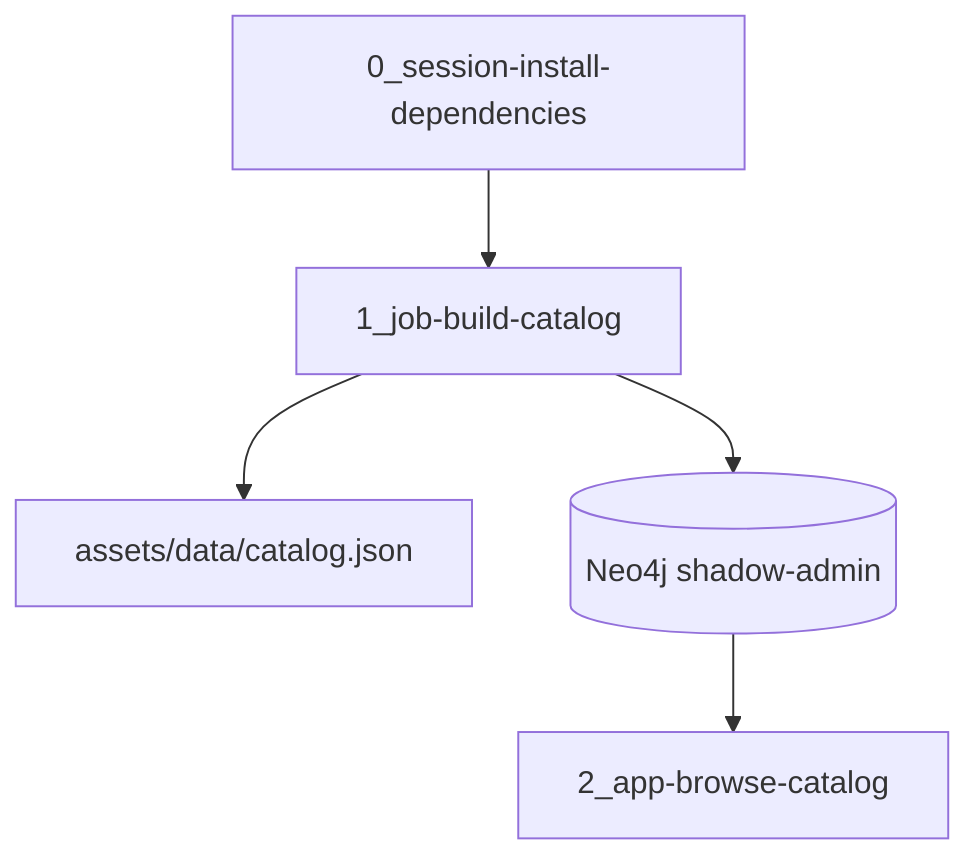

# Architecture

Cloudera Machine Learning is the launch target. Neo4j holds the posture graph. The semantic model that binds questions to that graph is described in [Semantic knowledge layer](semantic-knowledge-layer.md).

| Piece | Role |
| --- | --- |
| `src/cyber_semantic_layer` | Catalog model, sample catalog, JSON snapshot, Neo4j seed, and question bindings |
| `0_session-install-dependencies` | Job that installs the Neo4j driver from `requirements.txt`. PBJ runtimes fail AMP setup steps that run as sessions, so this step is a job. It does not build the project package |
| `1_job-build-catalog` | Writes the catalog snapshot and, when `NEO4J_URI` is set, seeds Neo4j. Imports the model from `src/`. A CML session does not set `__file__`, so the script finds the project from `CDSW_PROJECT_DIR` or `ML_PROJECT_DIR` |
| `2_app-browse-catalog` | Serves the question form and the posture comparison. Imports the model from `src/` |
| `deploy/docker-compose.yml` | Local Neo4j 5. Browser on port 7474, Bolt on port 7687 |
| `deploy/run-local.sh` | Starts Neo4j, runs the job, then serves the application |
| `.project-metadata.yaml` | CML runbook. PBJ Workbench on Python 3.12 or 3.13, and JupyterLab on Python 3.12, Standard edition |
| `METADATA.yaml` | Fields for the Cloudera blueprint website |
| `catalog-entry.yaml` | Entry for a custom CML AMP catalog |
| `images/` | Cover image and the example screenshots in the README |

## Request path

The application listens on `CDSW_APP_PORT` inside CML. Locally it listens on port 8080. `PORT` overrides both.

A GET or POST to `/` with a `question` parameter is matched in `prepare_question`. A match runs two Cypher queries and the path queries that draw the graphs. Unmatched text returns no answer. When `NEO4J_URI` is unset, or Neo4j is unreachable, the page keeps the match and reports that the query did not run.

The posture table under the form runs the four default questions the same way.

## Configuration

| Variable | Default | Used for |
| --- | --- | --- |
| `CATALOG_PATH` | `assets/data/catalog.json` | Snapshot path, relative to the repository root |
| `NEO4J_URI` | empty in the AMP; `bolt://localhost:7687` in `run-local.sh` | Seed and queries. An empty value skips Neo4j. CML has no Neo4j on localhost, so the catalog job still succeeds if the seed cannot connect |
| `NEO4J_REQUIRED` | unset in the AMP; `1` in `run-local.sh` | When set, a failed Neo4j seed fails the catalog job |
| `NEO4J_USER` | `neo4j` | Bolt user |
| `NEO4J_PASSWORD` | `cyber-semantic-layer` | Bolt password. Replace this outside the local demo |
| `PORT` | | Local listen port |
| `CDSW_APP_PORT` | | Listen port inside CML |

The seed retries for about a minute so the job can start while Neo4j is still opening Bolt.
