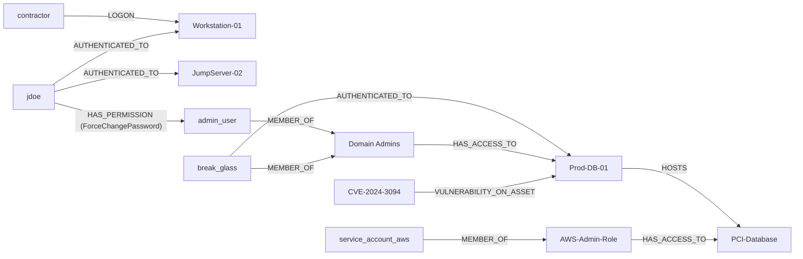

# Semantic knowledge layer

The semantic knowledge layer is the model that answers a posture question by following the relationships that question means. In this prototype that model is called Ossie. The same Neo4j graph is queried twice: once as a guessed walk that crosses edges of several types, and once along the Ossie path.

The build job also writes a catalog snapshot of entity kinds, kind-to-kind relationships, and metrics. That snapshot is the shared vocabulary for detections and dashboards. The browser answers questions against the graph.

## What a binding is

A guessed walk treats the graph as a set of edges. `[*1..4]` will cross a session, a password-reset right, and a group membership if they happen to connect the nodes in the pattern. Ossie assigns the words in the question to specific relationship types before the query runs.

| Question wording | Ossie binding |
| --- | --- |
| Reach | `HAS_PERMISSION` with value `ForceChangePassword`, then `MEMBER_OF`, then `HAS_ACCESS_TO`. A user who is already in such a group is included through `MEMBER_OF` and `HAS_ACCESS_TO`. |
| On (a host) | `AUTHENTICATED_TO`, the session relationship. |
| Read (a critical asset) | `MEMBER_OF` into a group that `HAS_ACCESS_TO` the asset, or `HAS_ACCESS_TO` a host that `HOSTS` the asset. |
| In (a group) | `MEMBER_OF`. |

Sessions stay sessions. `AUTHENTICATED_TO` and `LOGON` are recorded on the graph, and they stay out of reach, membership, and critical-asset answers.

## Graph vocabulary

| Label or type | Meaning in the demo |
| --- | --- |
| `User` | A principal. Also labeled `Principal`. |
| `Host` | A computer. Also labeled `Computer`. |
| `Group` | A directory or cloud role group. |
| `CriticalAsset` | An asset with a classification, here `pci`. |
| `Vulnerability` | A CVE found on a host. Also labeled `Vuln`. |
| `AUTHENTICATED_TO` | An authenticated session from a user to a host. |
| `LOGON` | A logon event. A different event type from a session. |
| `HAS_PERMISSION` | A right one user holds over another. The demo value is `ForceChangePassword`. |
| `MEMBER_OF` | Group membership. |
| `HAS_ACCESS_TO` | A group can open a host or a critical asset. |
| `HOSTS` | A host runs a critical asset. |
| `VULNERABILITY_ON_ASSET` | A vulnerability found on a host. |

Every demo node carries `demo: shadow-admin`. The seed deletes that subgraph, including the retired `inc-1042` tag, and leaves other nodes in the database alone.

## Demo graph

jdoe is a user with sessions on Workstation-01 and JumpServer-02, and a `ForceChangePassword` right over `admin_user`. jdoe has no `MEMBER_OF` edge into Domain Admins. `admin_user` and `break_glass` are the members of that group, and the group can open Prod-DB-01. `break_glass` also has a session on Prod-DB-01. Prod-DB-01 hosts PCI-Database. `service_account_aws` reaches that asset through AWS-Admin-Role. `contractor` has a logon on Workstation-01. CVE-2024-3094 sits on Prod-DB-01.

## How a question is answered

1. The browser matches the typed text to one of the four questions below. An exact prompt or title matches directly. Other wording is scored against phrases for each question. Raw Cypher and unrelated text stay unmatched.
2. The reach question can name another user. `which hosts can admin_user reach` rebinds both queries to that user. Accepted names are `jdoe`, `admin_user`, `service_account_aws`, `contractor`, and `break_glass`, including a few spacing and hyphen variants of those names. An unknown name returns the list of users the model has.
3. Neo4j runs the guessed walk and the Ossie path. The page shows both name lists and the paths those queries returned.

`NEO4J_URI` has to be set. When it is unset, the page shows the matched question and skips the query.

## Questions

### Shadow admin

Prompt: **Which hosts can jdoe reach?**

Reach means a password-reset right that lands on a host through group membership, or the caller's own group access. jdoe resets `admin_user`'s password, `admin_user` is in Domain Admins, and that group has access to Prod-DB-01.

| | Names |
| --- | --- |
| Guessed walk `[*1..4]` to any `Host` | JumpServer-02, Prod-DB-01, Workstation-01 |
| Ossie | Prod-DB-01 |

Workstation-01 and JumpServer-02 are sessions, so they leave the Ossie answer.

### Lateral movement

Prompt: **Who is on Workstation-01?**

On means an authenticated session.

| | Names |
| --- | --- |
| Guessed walk over `LOGON`, `HAS_SESSION`, or `AUTHENTICATED_TO` | contractor, jdoe |
| Ossie, `AUTHENTICATED_TO` only | jdoe |

`contractor` has a `LOGON` event. That event stays a logon, so contractor leaves the Ossie answer.

### Critical asset

Prompt: **Who can read PCI-Database?**

Read means group access to the critical asset. PCI-Database is a `CriticalAsset`. A walk that looks only for a `Host` of that name returns no names.

| | Names |
| --- | --- |
| Guessed walk to a `Host` named PCI-Database | none |
| Ossie | admin_user, break_glass, service_account_aws |

`service_account_aws` reaches the asset because AWS-Admin-Role has `HAS_ACCESS_TO` PCI-Database. `admin_user` and `break_glass` reach it because Domain Admins can open Prod-DB-01, and that host `HOSTS` the asset. jdoe's password-reset path is a reach path, so it stays on the shadow-admin question.

### Group membership

Prompt: **Who is in the Domain Admins group?**

In the group means `MEMBER_OF`.

| | Names |
| --- | --- |
| Guessed undirected walk of length 1 to 3 | admin_user, break_glass, jdoe |
| Ossie, `MEMBER_OF` only | admin_user, break_glass |

jdoe appears in the guessed walk because `HAS_PERMISSION` connects jdoe to `admin_user`, and `admin_user` is a member. That permission is a different relationship, so jdoe leaves the Ossie answer.

## Catalog snapshot

`SemanticCatalog` stores three registries:

- **Entities.** One named object with an id, a kind, a display name, and string attributes. Kinds are `asset`, `identity`, `alert`, `vulnerability`, and `incident`.
- **Relationships.** A directed link from one kind to another, such as `alert_on_asset` or `incident_groups_alert`. These describe kinds, and they are separate from the Neo4j relationship types above.
- **Metrics.** A named measure on one kind, with an aggregation. The sample defines `open_alert_count`, `critical_vulnerability_count`, and `open_incident_count`.

`1_job-build-catalog/job.py` writes this catalog to `assets/data/catalog.json` (override with `CATALOG_PATH`) and, when `NEO4J_URI` is set, seeds the graph in this document.
